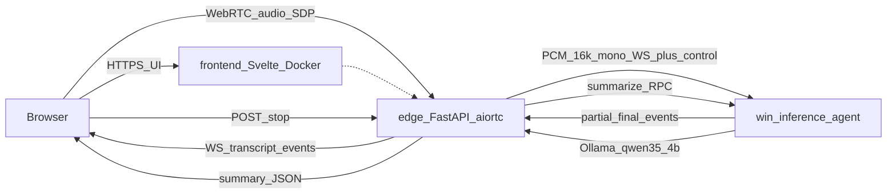

# System Design — transcript-buddy Realtime ASR

## 1. Mục tiêu sản phẩm

Ứng dụng web realtime speech-to-text:

- User mở web, cho phép mic, thu âm realtime
- Chọn model STT từ danh sách **faster-whisper đã tải sẵn** trên máy GPU: `tiny`, `small`, `large-v3`
- Live partial transcript trong lúc nói; final theo từng utterance
- Khi **Stop recording**: gửi toàn bộ transcript sang **Ollama `qwen3.5:4b`** để tóm tắt
- Không làm speaker diarization ở phase này

## 2. Topology đã chốt (Tailscale)

| Role | Host | Tailscale | IP |
| --- | --- | --- | --- |
| Frontend + Edge Backend (Docker Linux) | `new-home-server` / home-server | online | `100.116.37.109` |
| Inference Agent (Windows 11 + RTX 5060 Ti) | `pc` | online | `100.65.100.110` |
| LLM summarize | Ollama trên `pc` | local `127.0.0.1:11434` | model `qwen3.5:4b` |

Giao tiếp user → Linux qua Tailscale. Linux ↔ Windows **chỉ** qua Tailscale mesh (không expose GPU agent ra internet).



## 3. Phân tách dịch vụ

### 3.1 `frontend` (Docker Linux — Svelte + shadcn-svelte)

- UI: chọn model STT, Start/Stop recording, panel live / final / summary
- Mic qua `getUserMedia` → WebRTC tới edge
- Nhận transcript/summary qua WebSocket events
- Stack: SvelteKit, shadcn-svelte, Tailwind

### 3.2 `edge-api` (Docker Linux — FastAPI + aiortc)

- Signaling WebRTC (SDP/ICE)
- Audio track → PCM 16 kHz mono s16le
- Session lifecycle; proxy PCM + control tới Windows agent
- Forward partial/final/summary về browser
- **Không** chạy faster-whisper / Ollama

### 3.3 `inference-agent` — Whisper inference backend (native Windows trên `pc`)

Process **riêng** listen TCP port (mặc định **8100**). Edge Linux chỉ giao tiếp qua port này (Tailscale), không nhúng Whisper.

| Port / API | Mục đích |
| --- | --- |
| `8100` | Bind Whisper backend |
| `GET /health`, `GET /ready` | Sống / sẵn sàng |
| `GET /models`, `POST /warmup` | Catalog + preload GPU (thủ công; mặc định không preload lúc boot) |
| `WS /ws` | PCM + session control |
| `11434` | Ollama (process khác, summarize) |

- Startup: Windows Service `TranscriptWhisper` (`service/install.ps1`) hoặc `run.ps1` (dev)
- Công tắc: `sc start/stop TranscriptWhisper` (không cần GUI)
- faster-whisper CUDA từ `models/faster-whisper`
- Stop session → Ollama `qwen3.5:4b` summarize
- Chi tiết: `services/inference-agent/README.md`

## 4. Protocol Linux ↔ Windows

WebSocket + JSON control + binary PCM:

| Direction | Kind | Content |
| --- | --- | --- |
| Edge → Agent | text JSON | `session.open`, `session.stop`, `session.close`, `models.list` |
| Edge → Agent | binary | PCM s16le @ 16 kHz mono |
| Agent → Edge | text JSON | `agent.ready`, `transcript.partial`, `transcript.final`, `summary.done`, `error`, `models` |

Auth: `Authorization: Bearer $AGENT_TOKEN`.

## 5. Edge HTTP API

| Endpoint | Mục đích |
| --- | --- |
| `GET /api/health` | edge + ping agent |
| `GET /api/models` | danh sách model từ agent |
| `POST /api/sessions` | `{ model }` → `session_id` |
| `POST /api/sessions/{id}/webrtc/offer` | SDP offer → answer |
| `WS /api/sessions/{id}/events` | partial/final/summary/status |
| `POST /api/sessions/{id}/stop` | dừng + summarize |
| `DELETE /api/sessions/{id}` | cleanup |

## 6. STT & Summarize

- STT: faster-whisper `float16` CUDA; whitelist từ disk
- Partial: dùng `tiny` khi final model là `large-v3` / `medium`; ngược lại dùng cùng model hoặc `tiny`
- VAD: Silero ONNX / energy VAD trên agent
- Summarize: Ollama `qwen3.5:4b`, timeout 60s, output markdown ngắn

## 7. Deploy

**new-home-server:** `deploy/docker-compose.yml` — frontend + edge-api  
**pc:** chạy `services/inference-agent` native; Ollama local

Phase 1: client trong Tailscale mesh (không TURN). Không diarization, không lưu audio lâu dài.

## 8. Cấu trúc repo

```text
apps/frontend/
apps/edge-api/
services/inference-agent/
deploy/docker-compose.yml
models/faster-whisper/
docs/system-design.md
```
